# Sentrix Toolkit

**Open, read-only security and compliance tools by [Sentrix](https://sentrix.ca).** 
Outils ouverts de sécurité et de conformité, en lecture seule.

## What is in here

| Folder | Purpose |
| :-- | :-- |
| [`analyzers/`](analyzers) | Posture assessments that produce a report |
| [`checkers/`](checkers) | Single-control verifiers |
| [`tools/`](tools) | Utilities |
| [`mappings/`](mappings) | Control mappings between frameworks |
| [`templates/`](templates) | Starting template for a new tool |
| [`docs/`](docs) | Documentation |

Each tool lives in its own folder with a `README.md` and a `tool.yaml` manifest.

## Principles

- **Read-only.** Tools never change the systems they inspect.
- **No telemetry.** Nothing leaves your machine unless you send it.
- **Least privilege.** Each tool documents the permissions it needs.

## Disclaimer

These tools help assess a security posture. They are not a certification and do not replace an audit.

## Français

Ce dépôt regroupe les scripts publics de Sentrix, soit des analyses, des vérificateurs, des outils et des correspondances entre référentiels. Ils fonctionnent en lecture seule et sans télémétrie.

## Security

To report a vulnerability, see [SECURITY.md](SECURITY.md). Do not open a public issue.
